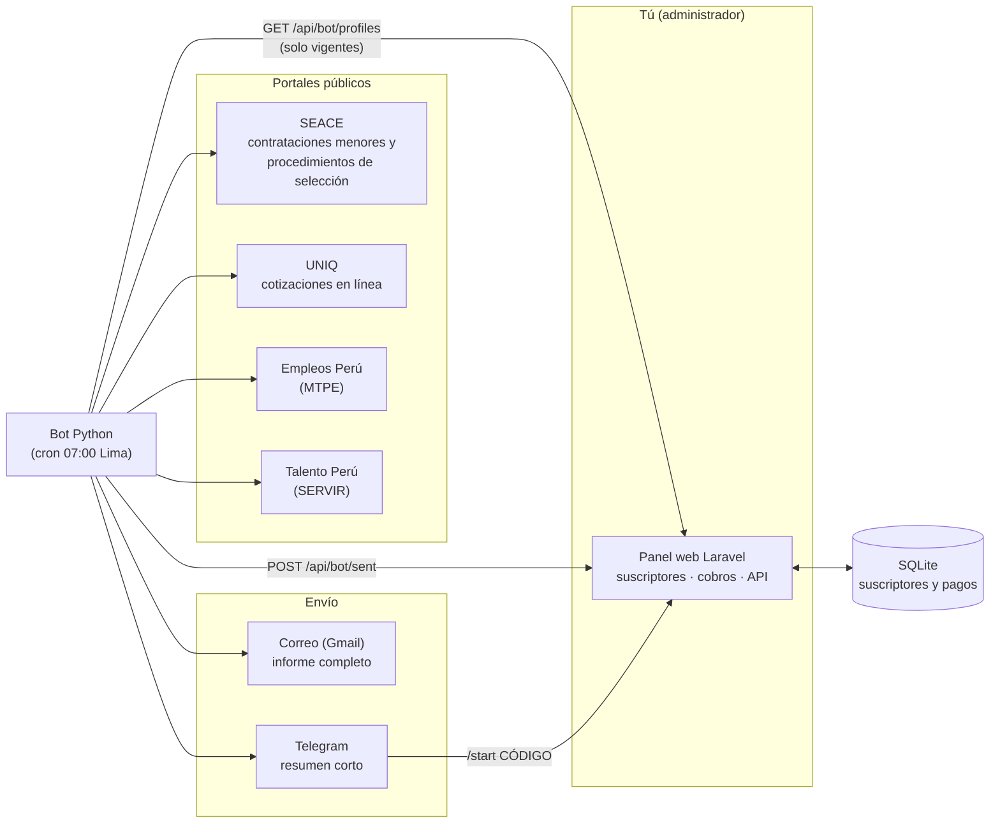
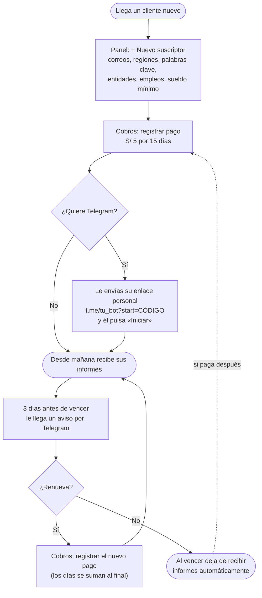
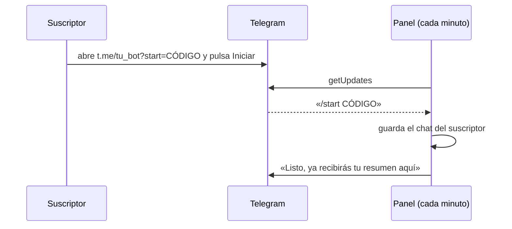

# NEOESTADO · Monitor de contrataciones públicas

Cada mañana revisa los portales del Estado peruano y le envía a cada suscriptor **solo lo que le interesa**, por correo y
por Telegram: compras y contrataciones (SEACE, UNIQ) y ofertas de empleo (Empleos Perú, SERVIR).

El administrador (tú) registra desde un panel web **qué quiere cada suscriptor** y **cobra S/ 5 por 15 días**. El resto
es automático.

---

## Qué hace, en simple

1. **Registras** a un suscriptor: sus correos, regiones, palabras clave, entidades, empleos y sueldo mínimo.
2. **Registras su pago** (Yape, Plin…). Con eso queda activo por 15 días.
3. **Cada día a las 07:00** el bot busca en los portales, arma el informe de cada uno y lo envía.
4. Si el suscriptor **no renueva**, deja de recibir informes solo. Al pagar de nuevo, vuelve solo.

## Arquitectura



| Pieza | Qué es | Dónde está |
|---|---|---|
| **Panel** | Aplicación Laravel (SQLite): suscriptores, cobros, API con tokens | `panel/` |
| **Bot** | Python: consulta los portales, arma y envía los informes | `bot.py`, `seace.py`, `uniq.py`, `empleos.py`, `informe.py` |
| **Panel antiguo** | Panel en Python sobre `perfiles.ini` (opcional) | `admin.py`, `admin.html` |
| **Docker local** | Todo junto para probar sin enviar nada real | `docker-compose.yml` |
| **Instalador del VPS** | Instala el bot aislado, con su propio usuario y cron | `install.sh` |

## Flujo de uso (lo que haces tú)



## Funcionamiento diario (lo que hace el sistema)


### Cómo se vincula Telegram



## Qué recibe un suscriptor

- **Correo:** informe completo con resumen, índice por búsqueda, ubicación (región › provincia › distrito), fechas de
  cierre, enlace a la ficha y **«Descargar requerimiento»** en las contrataciones menores.
- **Telegram:** resumen corto: cuántas novedades hay, las que cierran pronto y los empleos nuevos, con enlaces.

## Probarlo en tu computadora (Docker)

```bash
docker compose up -d --build                # panel Laravel + bandeja de correos de prueba + Telegram simulado
docker compose run --rm bot python bot.py   # el bot lee el panel y "envía" (a la bandeja de prueba)
```

| | Dirección |
|---|---|
| Panel (usuario `admin@neoestado.test`, clave `cambiar-esto-local`) | <http://127.0.0.1:8000> |
| Correos recibidos | <http://127.0.0.1:8025> |
| Mensajes de Telegram simulados | <http://127.0.0.1:8081/_falso/enviados> |

Nada sale a internet salvo las consultas a los portales públicos; no se envía ningún correo ni mensaje real.

## Ponerlo en producción

1. **Bot en el VPS:** `cd /root/cotizador && git pull && bash install.sh` (usuario propio, entorno aislado y cron;
   no toca otras aplicaciones del servidor).
2. **Secretos** en el `.env` del VPS (nunca en el repositorio): cuenta de Gmail y su contraseña de aplicación,
   `PANEL_URL` y `PANEL_TOKEN`, `TELEGRAM_BOT_TOKEN`.
3. **Panel:** corre en cualquier servidor con PHP. Si no quieres abrir puertos, `php artisan panel:export-perfiles`
   escribe los suscriptores como `perfiles.ini` y el bot los lee sin necesidad de conexión.
4. **Telegram:** crea el bot con @BotFather y pon `TELEGRAM_BOT_TOKEN` y `TELEGRAM_BOT_USERNAME` en el `.env` del panel.
   Deja corriendo `php artisan schedule:work` (o un cron cada minuto con `schedule:run`).
5. Cambia la clave del administrador y el token del bot, que en Docker son solo de prueba.

## Cobros

- Precio y duración en el `.env` del panel: `PANEL_PRICE=5`, `PANEL_DAYS=15`.
- **Cobros** > *Registrar un pago*: medio (Yape, Plin, transferencia, efectivo), N.º de operación y fecha.
- Si renueva antes de vencer, los días se suman al final; si ya venció, cuentan desde hoy.
- El pago es manual: tú confirmas el Yape o Plin y lo registras.

## Seguridad y límites

- Panel con sesión, tokens de API con permisos separados (el del bot solo lee y avisa lo enviado) y límite de intentos.
- Los portales no se saturan: las consultas van a ritmo controlado y se detienen si el portal limita el acceso.
- No se evaden captchas: el buscador clásico de SEACE 3.0 (con reCAPTCHA) no se automatiza; el informe enlaza a su portal.
- Las claves y los correos de los suscriptores **no** van a GitHub (`.env`, `perfiles.ini`, `data/` están ignorados).

## Pruebas

```bash
python test_bot.py                                                                 # bot: sin red
docker run --rm neoestado-panel sh -c "cp .env.example .env && php artisan test"   # panel Laravel
```

## Más detalle

Guía técnica completa (palabras clave, regiones, perfiles, límites del portal, instalación, desinstalación):
[docs/GUIA.md](docs/GUIA.md).
