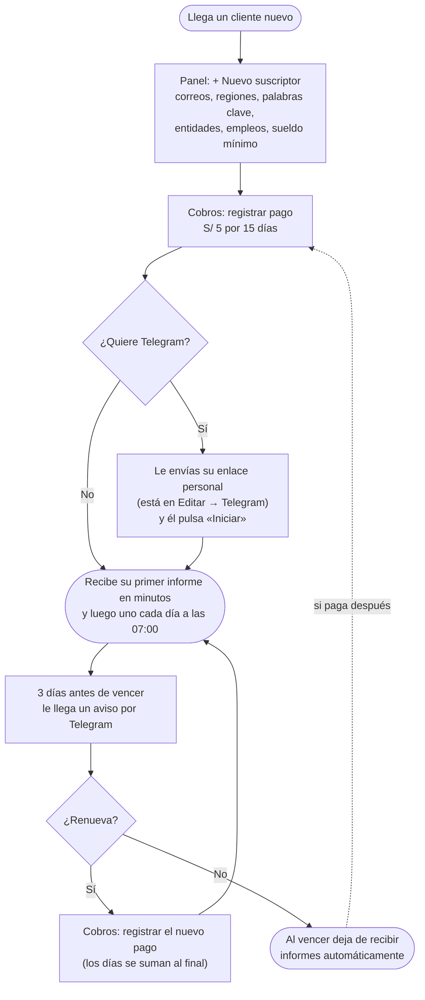
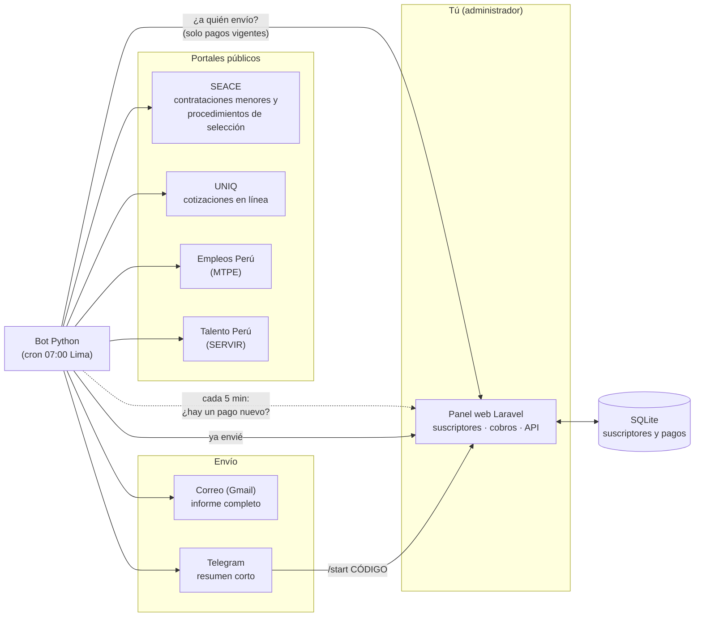
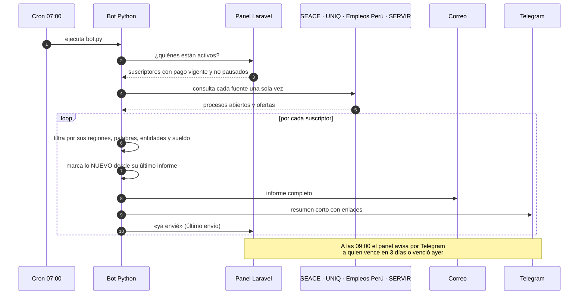
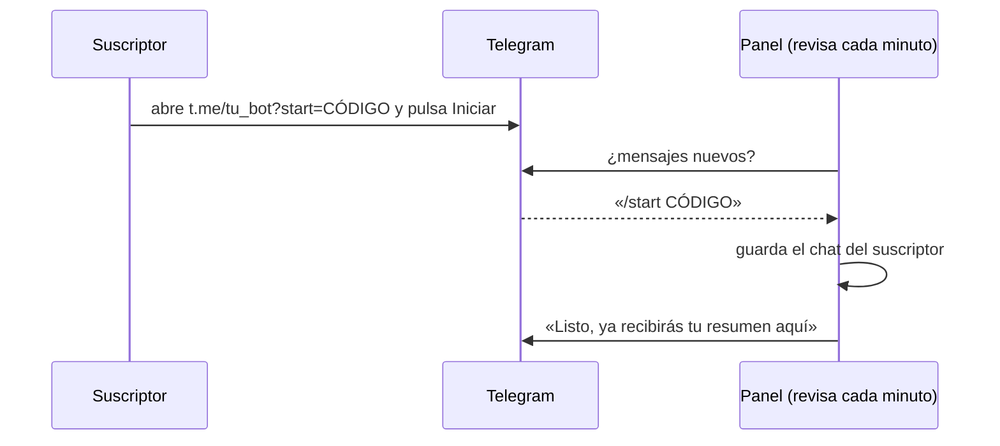

# NEOESTADO · Alertas de compras públicas y empleo

**NEOESTADO avisa cada mañana a cada suscriptor de lo que le interesa del Estado peruano:**
licitaciones y cotizaciones donde puede vender, y ofertas de trabajo donde puede postular.
Llega por **correo** (informe completo) y por **Telegram** (resumen corto).

Tú, el administrador, solo haces dos cosas: **registrar qué quiere cada suscriptor** y **registrar su pago**
(S/ 5 por 15 días). Lo demás es automático.

---

## Índice

1. [Qué revisa](#1-qué-revisa)
2. [Cómo funciona en 4 pasos](#2-cómo-funciona-en-4-pasos)
3. [Tu día a día como administrador](#3-tu-día-a-día-como-administrador)
4. [Qué recibe el suscriptor](#4-qué-recibe-el-suscriptor)
5. [Arquitectura](#5-arquitectura)
6. [Probarlo en tu computadora (Docker)](#6-probarlo-en-tu-computadora-docker)
7. [Ponerlo en producción](#7-ponerlo-en-producción)
8. [Atajo para llegar exacto a la oferta](#8-atajo-para-llegar-exacto-a-la-oferta)
9. [Problemas frecuentes](#9-problemas-frecuentes)
10. [Seguridad y límites](#10-seguridad-y-límites)

---

## 1. Qué revisa

| Portal | Qué trae | El enlace del informe lleva a… |
|---|---|---|
| **SEACE · contrataciones menores** | Cotizaciones de hasta 8 UIT | La ficha exacta, y **Descargar requerimiento** (TDR o especificaciones) |
| **SEACE · procedimientos de selección** | Licitaciones, concursos, subastas… | La ficha exacta y sus bases |
| **UNIQ** | Cotizaciones en línea de la Universidad Nacional Intercultural de Quillabamba | El TDR o las especificaciones técnicas |
| **Empleos Perú** (Ministerio de Trabajo) | Ofertas de empresas y del sector público | La oferta exacta |
| **Talento Perú** (SERVIR) | Convocatorias del sector público | El buscador de SERVIR (ver [sección 8](#8-atajo-para-llegar-exacto-a-la-oferta)) |

Cada suscriptor elige qué seguir:

- **Palabras clave**, por ejemplo `cemento`, `"sistema académico"`. Con comillas, las palabras deben ir juntas.
- **Regiones**, por ejemplo `CUSCO` o `APURIMAC/ABANCAY`. Las palabras clave se buscan solo ahí.
- **Entidades**, por ejemplo `UGEL LA CONVENCION`. Recibe todo lo que tengan abierto.
- **UNIQ**: sí o no.
- **Empleos**: palabras del puesto, regiones y sueldo mínimo.

## 2. Cómo funciona en 4 pasos

1. **Registras** al suscriptor en el panel con sus correos y lo que quiere seguir.
2. **Registras su pago** (Yape, Plin…): queda activo 15 días y **recibe su primer informe en unos minutos**.
3. **Cada día a las 07:00** (hora de Lima) recibe su informe con lo nuevo marcado.
4. Si **no renueva**, deja de recibir solo. Si paga de nuevo, vuelve solo.

## 3. Tu día a día como administrador

Todo se hace en el panel web.



**La pantalla principal** tiene tres partes:

- **Izquierda, los indicadores:** suscriptores, vigentes, por vencer, vencidos o sin pago, lo cobrado en el mes y cuántos tienen Telegram.
- **Centro, la tabla:** buscador, filtro por estado y paginación, con los más nuevos primero. Desde cada fila llegas a **Cobros**, **Editar** y **Más** (duplicar, enviar informe ahora, pausar, eliminar).
- **Derecha, los gráficos:** estado de las suscripciones, ingresos por mes, próximos vencimientos, regiones y palabras más usadas.

**Cobros:**

- Medio de pago (Yape, Plin, transferencia, efectivo), N.º de operación y fecha.
- Si renueva antes de vencer, los días se suman al final del período. Si ya venció, cuentan desde hoy.
- El cobro es manual: tú confirmas el Yape o Plin y lo registras. Yape y Plin no tienen API pública.
- El precio y los días se cambian en el `.env` del panel: `PANEL_PRICE=5` y `PANEL_DAYS=15`.

**Telegram:** no hace falta el número de celular. Cada suscriptor tiene un **enlace personal** (en *Editar → Telegram*).
Se lo mandas por WhatsApp o correo, él lo abre, pulsa **Iniciar** y queda vinculado solo.

## 4. Qué recibe el suscriptor

- **Correo:** el informe completo, con:
  - resumen e índice por búsqueda;
  - ubicación (región › provincia › distrito);
  - fechas de cierre y lo **NUEVO** marcado;
  - enlace a cada ficha y al requerimiento.
- **Telegram:** un resumen corto con cuántas novedades hay, lo que cierra pronto y los empleos nuevos, con enlaces.
  Con `/estado` ve hasta cuándo tiene el servicio.
- **Avisos:**
  - confirmación al registrar su pago;
  - recordatorio 3 días antes de vencer;
  - aviso el día después de vencer.

## 5. Arquitectura



| Pieza | Qué es | Dónde está |
|---|---|---|
| **Panel** | Aplicación Laravel con SQLite: suscriptores, cobros, tablero y API con tokens | `panel/` |
| **Bot** | Programa en Python que consulta los portales, arma y envía los informes | `bot.py`, `seace.py`, `uniq.py`, `empleos.py`, `informe.py` |
| **Script de navegador** | Rellena los buscadores de SERVIR y SEACE 3.0 | `userscripts/` |
| **Docker local** | Todo junto para probar sin enviar nada real | `docker-compose.yml` |
| **Instalador del VPS** | Instala el bot aislado, con su propio usuario y cron | `install.sh` |
| **Panel antiguo** (opcional) | Panel en Python sobre `perfiles.ini` | `admin.py`, `admin.html` |

**Qué pasa cada mañana:**



**Cómo se vincula Telegram:**



## 6. Probarlo en tu computadora (Docker)

Necesitas **Docker Desktop**. En la carpeta del proyecto:

```bash
docker compose up -d --build
```

| Qué | Dónde |
|---|---|
| Panel (usuario `admin@neoestado.test`, clave `cambiar-esto-local`) | <http://127.0.0.1:8000> |
| Correos enviados (bandeja de prueba) | <http://127.0.0.1:8025> |
| Mensajes de Telegram simulados | <http://127.0.0.1:8081/_falso/enviados> |

Para enviar el informe a un suscriptor:

```bash
docker compose run --rm bot python bot.py --perfil "Nombre del suscriptor"
```

Si quieres la prueba con datos reales, pon esto en un archivo **`.env` en la carpeta raíz** (junto a `docker-compose.yml`, no
dentro de `panel/`). Ese archivo no se sube a GitHub.

```
# Telegram real (de @BotFather)
TELEGRAM_BOT_TOKEN=123456789:AAH...
TELEGRAM_BOT_USERNAME=tu_bot
TELEGRAM_API_URL=https://api.telegram.org

# Correo real (Gmail con contraseña de aplicación)
SMTP_HOST=smtp.gmail.com
SMTP_PORT=587
SMTP_SEGURO=si
SMTP_USER=tu_cuenta@gmail.com
SMTP_PASS=tu_contraseña_de_aplicación
```

Después de cambiar el `.env`, ejecuta `docker compose up -d --force-recreate`. `docker compose restart` no relee el `.env`.

## 7. Ponerlo en producción

1. **Bot en el VPS:** ejecuta `cd /root/cotizador && git pull && bash install.sh`. Crea un usuario propio, un entorno aislado y el cron, y no toca otras aplicaciones del servidor.
2. **Secretos** en el `.env` del VPS, nunca en el repositorio:
   - la cuenta de Gmail y su contraseña de aplicación;
   - `PANEL_URL` y `PANEL_TOKEN`;
   - `TELEGRAM_BOT_TOKEN`.
3. **Panel:** corre en cualquier servidor con PHP. Si no quieres abrir puertos, `php artisan panel:export-perfiles` escribe los suscriptores como `perfiles.ini` y el bot los lee sin conexión.
4. **Telegram:** crea el bot con @BotFather y pon `TELEGRAM_BOT_TOKEN` y `TELEGRAM_BOT_USERNAME` en el `.env` del panel. Deja corriendo `php artisan schedule:work`, o un cron cada minuto con `php artisan schedule:run`.
5. **Cambia la clave del administrador y el token del bot.** Los de Docker son solo de prueba.

## 8. Atajo para llegar exacto a la oferta

SERVIR y el buscador clásico de SEACE 3.0 no tienen una dirección por oferta. Los enlaces de NEOESTADO llevan al final lo
que hay que buscar, y un **script de navegador** lo rellena por ti:

- **SERVIR:** escribe el número de convocatoria y el puesto, pulsa «Buscar» y queda **solo esa oferta**.
- **SEACE 3.0:** rellena año, número y sigla. El captcha y «Buscar» los pulsas tú.

**Instalar (una vez, en el navegador donde abres los enlaces):**

1. Instala la extensión **Tampermonkey** (Chrome, Edge, Firefox) o **Violentmonkey**.
2. Abre <https://raw.githubusercontent.com/RedyDelgado/cotizador/main/userscripts/neoestado.user.js> y pulsa **Instalar**.

**En el celular**, Chrome de Android no admite extensiones. Tienes estas opciones:

- **Telegram:** el número de convocatoria de SERVIR se **copia con un toque**. Abres el enlace, lo pegas en «Número de convocatoria» y buscas. Las ofertas de Empleos Perú ya abren la oferta exacta.
- **Firefox para Android** con Violentmonkey, o **Kiwi Browser:** el script funciona igual.
- **iPhone:** la app gratuita *Userscripts* para Safari.

Sin el script los enlaces siguen funcionando: abren el buscador normal.

## 9. Problemas frecuentes

| Síntoma | Causa y solución |
|---|---|
| El suscriptor no recibe nada | Su pago venció o no tiene ninguno, o está en pausa. Revisa la columna **Servicio** de la tabla. |
| Llega a Telegram pero no al correo (en Docker) | El correo va a la bandeja de prueba (<http://127.0.0.1:8025>). Para Gmail real, completa el `.env` ([sección 6](#6-probarlo-en-tu-computadora-docker)). |
| El enlace de Telegram dice `neoestado_local_bot` | Docker no leyó tu `.env`: debe estar en la carpeta raíz. Luego `docker compose up -d --force-recreate`. |
| El bot no responde al «Iniciar» | Token mal copiado, o el servicio `planificador` está detenido (`docker compose ps`). |
| En el informe sale «SIN RESPUESTA» en una fuente | El portal no respondió o limitó las consultas. El resto del informe sale igual y lo que faltó se completa al día siguiente. |
| Un enlace de SERVIR abre el buscador y no la oferta | Es normal en SERVIR. Instala el script ([sección 8](#8-atajo-para-llegar-exacto-a-la-oferta)) o pega el número de convocatoria. |

## 10. Seguridad y límites

- El panel pide sesión. La API usa tokens con permisos separados: el del bot solo lee y avisa lo enviado.
- Los portales no se saturan: las consultas van a ritmo controlado y se detienen si el portal limita el acceso.
- No se evaden captchas: SEACE 3.0 (con reCAPTCHA) no se automatiza.
- Las claves y los correos de los suscriptores **no** van a GitHub: `.env`, `perfiles.ini`, `data/` y `docker-data/` están ignorados.

**Pruebas automáticas:**

```bash
python test_bot.py                                                                 # bot (sin red)
docker run --rm neoestado-panel sh -c "cp .env.example .env && php artisan test"   # panel Laravel
```

**Guía técnica completa** (sintaxis de palabras clave, regiones, perfiles, límites del portal, instalación y desinstalación):
[docs/GUIA.md](docs/GUIA.md).
